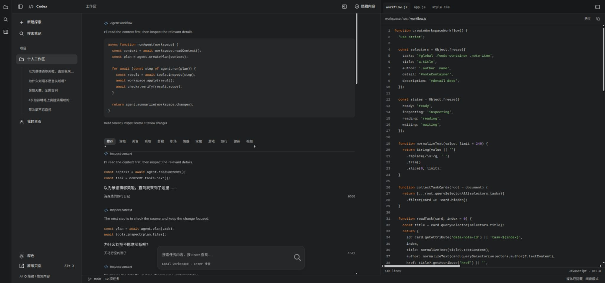

# 小红书 · Codex 桌面外观

[**一键安装油猴脚本**](https://raw.githubusercontent.com/troyluce/xiaohongshu-codex-userscript/main/xiaohongshu-codex.user.js) · [安装包](xiaohongshu-codex-v1.1.0.zip) · [工程源码](xiaohongshu-codex-source-v1.1.0.zip)

把小红书网页版换成 Codex 风格工作区：窄活动栏、项目侧栏、中间智能体流程与笔记、右侧源码编辑器。默认隐藏图片和视频，打开笔记后可按需显示。



## 安装

1. 在 Edge / Chrome / Firefox 安装 Tampermonkey（篡改猴）或 Violentmonkey。
2. 点击上面的「一键安装」，在油猴安装页点击「安装」。
3. 打开或刷新 https://www.xiaohongshu.com/explore 。

如果浏览器将脚本显示为文本，可在油猴「添加新脚本」中粘贴文件全部内容并保存。同站点一次启用一套外观脚本，先停用其他小红书皮肤。脚本包含本仓库的自动更新地址。

## 功能

- 中间显示智能体流程代码、步骤和原生笔记，保留标题链接及原生评论、点赞、收藏、关注入口。
- 右侧显示实际工程的 `workflow.js`、`app.js`、`style.css`，支持文件标签、行号、高亮、换行、复制与左右方向键切换。
- 深色、浅色和跟随系统三种主题；窄窗口可切换源码面板。
- 媒体默认隐藏；源码覆盖层或遮挡模式暂停原页面媒体。
- 关闭外观后恢复标题、图标、搜索框与原生交互。

| 操作 | 快捷键 / 入口 |
| --- | --- |
| 隐藏 / 恢复内容 | `Alt+Q` 或顶栏盾牌 |
| 切换原版 / Codex | `Alt+X` 或侧栏「原版页面」 |
| 查看源码 | 顶栏分栏按钮 |
| 显示图片、视频 | 笔记详情右上角眼睛按钮 |
| 搜索 | 中间底部原生输入框，按 Enter |

智能体流程用于界面伪装展示，右栏为实际工程源码。隐藏媒体不阻止小红书自身加载网络资源。账号登录与访问权限由原站处理。

## 工程与验证

仓库中的 `.user.js` 是无需构建的自包含安装文件。工程源码 ZIP 提供源文件、构建工具和匿名 DOM 测试夹具，解压后可执行：

```sh
npm ci
npm run build
npm test
npm run check
```

24 项 DOM 行为测试通过；已检查 2048×960、1210×1235 和 390×844 浏览器预览、源码复制、媒体与原版恢复。测试夹具依据当前小红书 DOM 结构制作，使用示例内容。

## 来源与许可

参考 [czm15053/linuxdo-idea-ui](https://github.com/czm15053/linuxdo-idea-ui) 的 Codex 配色和小红书页面选择器，保留作者 MIT 版权声明，见 [LICENSE](LICENSE)。
